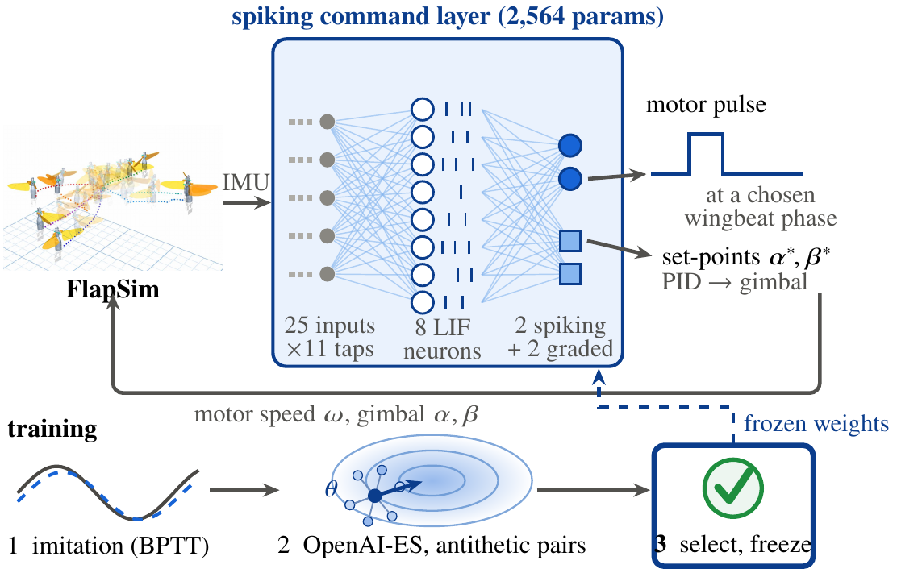

# PulseFlap

Code and data for the paper **"A Phase-Timed Pulse Channel to Robust Flapping-Wing Manoeuvres"**.

A single-motor flapping-wing robot can pitch itself within one wingbeat without any extra actuator: a motor pulse of a
few milliseconds at a chosen crank phase makes the next stroke asymmetric, and a pulse near 135° pitches the body up
while one near 315° pitches it down. The paper calls this the phase-timed pulse channel and asks how much of a
controller's robustness comes from using this channel during a manoeuvre, and how much from learning. Six controllers
fly the same test cases in the FlapSim simulator: a classical controller that keeps its hand-designed pulse law off
during manoeuvres, the same controller tuned by evolution strategies, the classical controller with the pulse law left
on, a spiking neural network (SNN) that times pulses from the IMU alone, an MLP trained with PPO, and the SNN combined
with the pulse law. Under impulsive torque hits the untuned pulse law, kept on, crashes least; under stronger sustained
disturbance the learned controllers crash less, provided each pulse is at least as effective as the simulation
predicts.

<p align="center"></p>

This repository holds the paper's experiment code, the frozen controllers, every per-episode result row flown on the
workstation, summaries of the cluster runs, and the scripts that draw the figures. The simulator itself is
[FlapSim](https://github.com/MingshanHe/FlapSim), which is fetched separately at the commit the paper used.

## Contents

```
pulseflap/
  spike_steer/   the paper's experiment modules (benchmark, controllers, test sets, analyses), close to the code that
                 produced the results; FlapSim is imported from the separate clone
  controllers/   the compared controllers under readable names (pulse law, classical, classical + pulse law, SNN,
                 SNN ablations, MLP + PPO, SNN + pulse law)
  tasks/         test cases, hit / disturbance / sensor conditions, vehicle variants, scoring, episode runner
  eval/          paired Δ with bootstrap CI, exact McNemar, Clopper-Pearson, Holm
  workspace.py   builds the folder layout the modules expect (see "How the code is organised")
  run.py         runs any module with its original command line inside the workspace
experiments/     quick start, re-fly and comparison tools, Table I check, one script per group of results
weights/         frozen controllers: classical schedules and pulse law, classical + ES, SNN seeds, PPO checkpoints
data/            per-episode rows (workstation), plan summaries, cluster summary tables, figure data (data/README.md)
figures/         plot_figures.py (Figs. 2, 4-7), check_figure_data.py, tikz/ (Figs. 1 and 3)
calibration/     fixed-base load measurements of the wing mechanism (Fig. 2)
scripts/         setup_flapsim.sh
```

## Requirements

- Linux and Python 3.11 (the runs used Ubuntu 24.04 under WSL2 and a 20-core CPU; the experiment pools rely on the
  `fork` start method).
- A C++ compiler: FlapSim compiles its native aerodynamics backend on first use.
- The Python packages in `requirements.txt`: MuJoCo 3.8, numpy, scipy, neat-python, matplotlib; torch, gymnasium and
  stable-baselines3 for the MLP + PPO arm.
- `git` to fetch FlapSim; `pdflatex` with TikZ only to rebuild Figs. 1 and 3.

No GPU is needed. An episode takes about 15 s of CPU time.

## Setup

```bash
git clone https://github.com/MingshanHe/PulseFlap.git
cd PulseFlap
python3.11 -m venv .venv && source .venv/bin/activate      # or a conda environment with Python 3.11
pip install -r requirements.txt
bash scripts/setup_flapsim.sh
```

`setup_flapsim.sh` clones FlapSim into `third_party/FlapSim` (ignored by git) and checks out commit `deab6c8`
(branch `research/original-env-snn-neat`), the version used for every result in the paper. It uses a sparse checkout
of the simulator, its experiment packages and the robot model (about 85 MB); `FULL=1 bash scripts/setup_flapsim.sh`
checks out the whole commit (about 1 GB). Importing `pulseflap` puts the clone on `sys.path`, so FlapSim needs no
install step. To use a FlapSim checkout elsewhere, set `FLAPSIM_ROOT` to it.

## Quick start

Fly one episode of the main hit set with every controller and compare it with the stored row of the same case:

```bash
python experiments/quickstart.py
```

```
set kick, task evade, case seed 2099300000, class pitch, hit at 0.249 s after the command
controller                         flown    score pulses   stored row (flown, score, pulses)
Classical                           True   1.2080     41    True   1.2080     41   identical
Classical + ES (seed 1)             True   1.1851     41    True   1.1851     41   identical
Classical + pulse law               True   0.9897     69    True   0.9897     69   identical
SNN (seed 1)                        True   1.1339     49    True   1.1339     49   identical
SNN, pulses suppressed              True   1.2115     59    True   1.2115     59   identical
SNN, set-points zeroed              True   2.6800      7    True   2.6800      7   identical
SNN, imitation only                 True   1.2305     53    True   1.2305     53   identical
SNN + pulse law (reconstruction)    True   0.9687     68
MLP + PPO (seed 1)                  True   0.9898     38    True   0.9898     38   identical
```

This takes about two minutes. On another machine the rows will match only approximately (see "Reproducibility").
`--task`, `--case` and `--set nominal` pick other cases; on the nominal set the stored PPO rows come from the second
machine and differ slightly even here.

Then re-fly a sample and check it against the stored rows field by field, recompute Table I from the stored rows, and
redraw the figures:

```bash
python experiments/refly.py --set kick --arms classical,probe,snn11_s1 --n 4 --workers 12   # 36 episodes
python experiments/table_main.py                                                          # a few seconds
python figures/plot_figures.py                                                            # -> figures/out/
```

`refly.py --list` shows every stored set and the arms stored for it; any of them can be re-flown.

## Paper results and where they come from

Workstation numbers are recomputed from `data/rows` by `experiments/table_main.py` and `figures/check_figure_data.py`;
cluster numbers are read from `data/cluster`. Crashes are counts of crashed episodes; ranges are over seeds.

| Paper | Re-fly | Analysis / figure | Data | Expected |
|---|---|---|---|---|
| Fig. 1, overview | | `figures/tikz/overview_diagram.tex` | | |
| Fig. 2, calibration (Sec. III-C) | | `plot_figures.py calibration` | `calibration/*.csv` | uncalibrated mean-lift error 7.86 / 6.87 / 3.93 / 46.96 % (blade element, Flappy, Sane-Dickinson, MuJoCo ellipsoid) |
| Fig. 3, controller structure | | `figures/tikz/controller_diagram.tex` | | |
| Table I, hit, workstation (192) | `robustness.sh` | `table_main.py` | `rows/v12/kick`, `rows/v14/kick__*` | classical 60, classical + ES 56–58, SNN pulses suppressed 62–93, classical + pulse law 5, SNN 22–40, MLP + PPO 41–47, set-points zeroed 33–54, imitation only 23–32; seeds better than classical + pulse law 0/5, 0/5 |
| Table I, ×1.5 and ×1.75, workstation (192) | `sustained.sh` | `table_main.py` | `rows/v16`, `rows/v14/v16_*` | ×1.5: 32, 34, 12, SNN 1–7, PPO 5–10 (1/5, 0/5 better); ×1.75: 160, 157, 137, SNN 84–90, PPO 86–92 (5/5, 5/5) |
| Table I, cluster columns | cluster | `table_main.py` | `cluster/p4_*`, `p5_*`, `p6_*` | hit (768): 182, 171–179, 14, SNN 68–134, PPO 116–125; ×1.5 (576): 116, 104, 60, 9–30, 18–43; ×1.75: 449, 448, 417, 214–221, 214–229; SNN + pulse law 0–14 of 192 |
| Sec. V-A, nominal | `nominal.sh` | `table_main.py` | `rows/v11`, `rows/v14/nominal__*` | classical + pulse law Δ = −0.13 [−0.19, −0.09] vs classical, no crash; SNN Δ −0.06 to +0.06, no crash |
| Sec. V-B, hits; Fig. 4 | `robustness.sh` | `table_main.py`, `plot_figures.py robustness`, `python -m pulseflap.run holm` | `rows/v12`, `rows/v13`, `rows/v14`, `figures/robustness_crashes.json`, `figures/pulse_law_crashes.json` | 4/5 SNN seeds pass H1 against classical; replication: classical 42, SNN 16–39; 4.5 mN·m: classical + pulse law 30 vs 46–95; pulse law crash rate 2.6 % [0.9, 6.0]; Holm table `summaries/holm/holm.txt` |
| Sec. V-B, tuned pulse law | cluster | | `cluster/p3_tuned_pulse_law.json` | tuned laws 4–7 hit crashes vs 5; nominal Δ −0.026 to −0.033 |
| Sec. V-C, channel ablations | `robustness.sh` (ablate14) | `table_main.py` | `rows/v14/kick__snn11_s*_{nopulse,noref}`, `kick__snn_bc_s*` | see Table I rows |
| Sec. V-D, sustained disturbance | `sustained.sh` | `python -m pulseflap.run blind16 report` | `rows/v16`, `cluster/p5_*` | as Table I; SNN minus PPO family at ×1.5 (cluster): −0.21 [−0.33, −0.09] |
| Fig. 5, pulse authority (Sec. V-E) | cluster | `plot_figures.py authority` | `cluster/q2_pulse_authority.json` | classical + pulse law < every SNN seed under the hit at 0.98–3.03 rad/s |
| Sec. V-F, integration step | `step_size.sh` | `python -m pulseflap.run stepsize_q1 report` | `rows/q1`, `summaries/q1` | 10 µs: classical + pulse law 50 vs 5 hit crashes; 2.5 µs within 4 crashes of 5 µs for every arm |
| Fig. 6 and Sec. V-G, vehicle variants | `vehicle_variants.sh` (workstation part); cluster | `plot_figures.py generalisation`, `python -m pulseflap.run blind15 table` | `rows/v15`, `cluster/p1_vehicle_variants.json` | classical + pulse law crashes only on voltage −10 % (9 vs 17); no vehicle with ≥ 3/5 SNN seeds better |
| Sec. V-H, SNN + pulse law | cluster | | `cluster/p6_snn_plus_pulse_law.json` | 0–14 hit crashes; nominal Δ +0.05 to +0.30 |
| Fig. 7, pulse timing (Sec. V-I) | `cost_energy_phase.sh` (pulse_phase) | `plot_figures.py phase`, `check_figure_data.py` | `figures/cost_energy_phase.json`, `summaries/pulse_phase` | 5,865 SNN pulses: 95.7 % within ±45°, 56.5 % within ±22.5° (printed as 96 and 57 %); pulse law 97.4 and 53.5 % |
| Sec. V-J, cost, energy, weight damage | `cost_energy_phase.sh` | | `summaries/compute_cost`, `summaries/energy`, `summaries/damage`, `rows/damage`, `cluster/es_refinement_pilot.json` | 2,564 vs 8,067 parameters; motor energy within about 1 % of classical |

`python -m pulseflap.run <module> report ...` reruns a module's own analysis on the stored rows (for example
`blind12 report --test kick`, `blind13 table`, `blind15 table`, `blind16 report`, `stepsize_q1 report`, `damage report`);
the results go to `work/`. (`ablate14 report` predates the later files in `rows/v14` and stops on them; its output is
stored in `data/summaries/plan_v14/summary_d1_d4.json`.)

## Reproduce

The scripts in `experiments/` fly every arm of a group of results again with the module and command that produced the
stored rows. They write into a fresh workspace (`work_rerun/`, set `WORK` to change it) that holds the case lists but
no stored results, and never touch `data/`. Compare a finished re-run with the stored rows with
`python experiments/compare_rows.py work_rerun`. `WORKERS` sets the number of processes (default: all cores).

| Script | Results | Episodes | Core-hours (about) |
|---|---|---|---|
| `nominal.sh` | Sec. V-A | 3,500 | 15 |
| `robustness.sh` | Table I hit column, Fig. 4, Secs. V-B and V-C, Holm | 49,000 | 205 |
| `sustained.sh` | Table I ×1.5 / ×1.75 workstation, Sec. V-D | 7,500 | 31 |
| `vehicle_variants.sh` | Sec. V-G, workstation part | 34,500 | 145 |
| `step_size.sh` | Sec. V-F | 11,000 (half of them at 2.5 µs) | 97 |
| `cost_energy_phase.sh` | Fig. 7, Secs. V-I and V-J | 25,000 | 105 |

All workstation results together take about 600 core-hours, or about 30 hours on 20 cores. The cluster results took
892 core-hours (`data/cluster/core_hours.json`). `experiments/training.sh` lists the training commands for the SNN,
classical + ES and PPO controllers; training was not re-run for this repository.

## Reproducibility

FlapSim's dynamics are chaotic, and single episodes depend on the floating-point behaviour of the compiler, libm and
CPU. The numbers are bit-reproducible on one machine but differ slightly between machines, so every comparison in the
paper is paired on identical cases flown on one machine.

- On the workstation used to assemble this repository, re-flown episodes match the stored rows exactly for the
  classical arms, classical + pulse law, the SNN arms and their ablations, and for MLP + PPO on the sets it flew
  itself (`experiments/refly.py`).
- The stored rows come from two machines with bit-identical results for every non-PPO arm. MLP + PPO episodes differ
  between them (float32 torch inference); the PPO rows of the nominal and main hit sets come from the second machine,
  and `data/rows/q1/dt5/kick` holds the first machine's own PPO rows on the main hit cases. `data/README.md` lists the
  provenance of every folder.
- On a different machine, expect the same crash counts and paired differences up to the case-to-case noise, not
  identical rows. Compare arms with each other on your own re-run rather than with the stored rows.

## Not included

- **Cluster per-episode rows.** The cluster results (Table I cluster columns, Figs. 5 and 6, the tuned pulse law and
  SNN + pulse law) are included as summary tables in `data/cluster/` only; the rows are not in this repository yet.
- **Cluster-only code.** The drivers of the tuned-law search, the authority sweep and the SNN + pulse law arm ran only
  on the cluster. `pulseflap.controllers.SNNPlusPulseLaw` re-implements the hybrid from its description and has not
  been checked against the cluster numbers.
- **FlapSim.** The simulator, robot model and sensor models are not copied here; see Setup.
- Raw trajectories and videos.

## How the code is organised

`pulseflap/spike_steer/` contains the experiment modules as they were run, with only their imports changed: modules of
the paper import each other from `pulseflap.spike_steer`, and everything else comes from FlapSim. From FlapSim,
PulseFlap uses the `flapsim` package (MuJoCo model, native aerodynamics and motor backend), FlapSim's experiment
packages `experiments.algorithms.{robust_control, snn_pid_compare, topology_hover, neuro_gates, wingbeat_snn,
wingbeat_feasibility, hover9, neat_imu, pid_airborne}` (environment, IMU and range-sensor models, the PID reflex layer,
handover gates, the wingbeat-phase estimator), and the robot model in `artifacts/pid_airborne_20261008`.

The modules read and write paths relative to the current directory (`artifacts/spike_steer/...` for controllers and
summaries, `runs/spike_steer/...` for rows). `pulseflap.workspace` builds that layout in `work/` from `weights/` and
`data/`, and `python -m pulseflap.run <module> <args>` runs a module there with its original command line, for example

```bash
python -m pulseflap.run blind12 run --test kick --arms classical,snn11_s1 --workers 16
python -m pulseflap.run blind12 report --test kick
```

Arms whose rows already exist are skipped by the `run` stages; use `python -m pulseflap.run --fresh --work <dir> ...`
to fly them again in a separate workspace.

## Citation

The citation will be added when the paper is published (`CITATION.cff`).

## License

MIT, see `LICENSE`. FlapSim is a separate project with its own terms.
